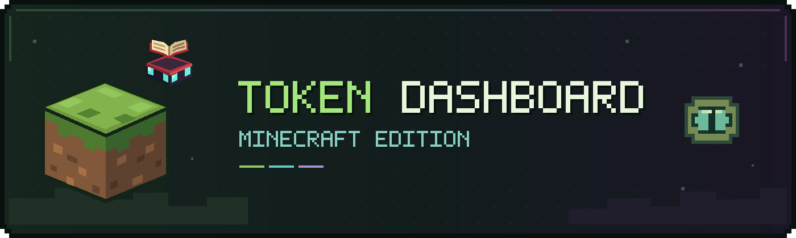
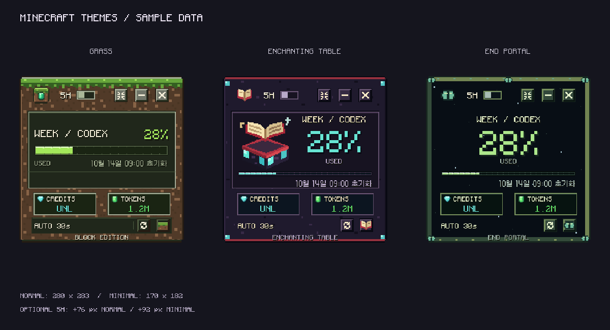

<a id="token-dashboard"></a>

<p align="center">
  
</p>

<p align="center">
  <b>작은 화면에 담은 Codex 사용량 · A little HUD for your Codex usage</b><br>
  <sub>Grass · Enchanting Table · End Portal</sub>
</p>

<p align="center">
  <a href="#한국어">한국어</a> ·
  <a href="#english">English</a> ·
  <a href="https://github.com/dhking1123/TokenDashboard/releases/download/v1.5.0/CodexUsageDashboard-Windows-x64.zip">Windows</a> ·
  <a href="#macos-downloads">macOS</a> ·
  <a href="docs/CHANGELOG.md">Changelog</a>
</p>

<p align="center">
  <br>
  <sub>실제 위젯 화면 · 예시 데이터 / Actual widget renders · Sample data</sub>
</p>

---

## 한국어

### ⛏️ Minecraft Edition

**Codex 사용량을 게임 HUD처럼, 항상 눈앞에.**

Windows/macOS용 비공식 데스크톱 위젯입니다. 주간 사용량을 기본으로 표시하고, 필요할 때만 5시간 한도를 펼칩니다. 항상 위에 표시되는 작은 창에서 사용률과 잔여량을 확인하세요.

| 테마 | 모습 |
| :--- | :--- |
| **Grass** | 잔디·흙 블록, 돌 버튼, 인벤토리 슬롯 |
| **Enchanting Table** | 인챈트 테이블, 펼친 책, 마법 문양 |
| **End Portal** | 엔드 차원문 프레임, 엔더의 눈, 별빛 내부 |

- **픽셀 HUD:** Monocraft 영문·숫자와 Galmuri9 한글 폰트를 앱에 동봉합니다.
- **아이템 표시:** 다이아몬드 아이콘은 `CREDITS`, 에메랄드 아이콘은 `TOKENS`입니다.
- **작은 창:** 일반 `280 × 283`, 미니멀 `170 × 182`. 5H를 켜면 높이만 각각 76px·92px 늘어납니다.
- **30초 자동 새로고침:** 사용량 조회와 조회 프로세스 정리를 유지합니다.

> **소스와 다운로드 버전 안내**
>
> `main` 소스에는 Minecraft Edition이 반영되어 있습니다. 아래 ZIP은 **이전 안정 배포판 v1.5.0**이며, Minecraft Edition 실행 파일은 아직 GitHub 릴리스에 게시하지 않았습니다. 새 디자인을 사용하려면 현재 소스로 실행하거나 빌드하세요. 새 테마의 실제 macOS 실행은 검증하지 않았습니다.

### 📦 다운로드

<a id="macos-downloads"></a>

| 시스템 | 이전 안정 배포판 다운로드 |
| :--- | :--- |
| Windows · x64 | [Windows ZIP · v1.5.0](https://github.com/dhking1123/TokenDashboard/releases/download/v1.5.0/CodexUsageDashboard-Windows-x64.zip) |
| macOS · Apple Silicon | [arm64 ZIP · v1.5.0](https://github.com/dhking1123/TokenDashboard/releases/download/v1.5.0-macos/TokenDashboard-macOS-arm64.zip) |
| macOS · Intel | [x86_64 ZIP · v1.5.0](https://github.com/dhking1123/TokenDashboard/releases/download/v1.5.0-macos/TokenDashboard-macOS-x86_64.zip) |

**압축 해제 → 앱 실행 → 사용량 확인.** 배포 앱은 Python 설치가 필요 없습니다. Codex 앱 또는 CLI가 설치되어 있고 본인 계정으로 로그인되어 있어야 합니다.

- **Windows:** `CodexUsageDashboard.exe`를 실행합니다.
- **macOS 13 이상:** `TokenDashboard.app`을 응용 프로그램 폴더로 옮겨 실행합니다. [macOS 설치·경로 안내](docs/macOS.md)

Windows EXE는 미서명이며, macOS 앱은 ad-hoc 서명만 있고 Apple Developer ID 서명·공증은 없습니다. 첫 실행이 차단되면 출처를 확인한 뒤 해당 앱만 개별 승인하세요. 기존 macOS 배포판의 빌드·UI·패키지 실행 검사는 수행했지만 실제 Mac 계정의 사용량 조회는 미검증입니다.

### 🎮 조작

| 조작 | 동작 |
| :--- | :--- |
| WEEK / 5H 영역 더블클릭 | 해당 항목의 `USED` 사용률 ↔ `LEFT` 잔여량 전환 |
| 상단 5H 토글 | 5시간 영역 표시 / 숨김 |
| 상단 크기 버튼 | 일반 / 미니멀 전환, 오른쪽 상단 위치 유지 |
| 상단 `−` / `×` | 최소화 / 종료 |
| 일반 모드 하단 새로고침 | 즉시 조회, 자동 조회는 30초마다 |
| 일반 모드 하단 테마 버튼 | **Grass → Enchanting Table → End Portal** 순환 |

테마, 5H 표시 여부, 항목별 USED/LEFT 선택을 저장합니다. `USED` 게이지는 왼쪽부터, `LEFT`는 오른쪽부터 채웁니다.

실제 사용률 **70% 이상은 노란색**, **90% 이상은 빨간색**으로 경고합니다. 잔여량 보기에서도 실제 사용률이 기준입니다. `✓`는 전량 사용 가능, 자물쇠는 한도 소진, `--`는 데이터 없음 또는 조회 실패를 뜻합니다.

### 🔎 데이터와 개인정보

**사용량만 조회합니다. 모델 응답을 생성하지 않습니다.**

설치된 `codex app-server`의 `account/read`, `account/rateLimits/read`, `account/usage/read`를 호출합니다. 모델 생성 요청을 보내지 않으므로 이 앱의 조회로 모델 생성 토큰을 사용하지 않습니다. 배포 파일에는 로그인 정보나 개인 사용 기록을 넣지 않습니다.

5시간 본 한도는 **CODEX**, 별도 Spark 한도는 **SPARK**로 표시합니다. **TOKENS는 서버가 반환하는 누적값이며 남은 구독 토큰 수가 아닙니다.** 제공되는 항목은 Codex 버전·계정·플랜에 따라 달라질 수 있습니다. 내부 조회 인터페이스가 바뀌면 앱 업데이트가 필요할 수 있습니다.

<details>
<summary><b>설정 저장 위치</b></summary>

| 실행 방식 | 경로 |
| :--- | :--- |
| Windows EXE | `%LOCALAPPDATA%\CodexUsageDashboard\settings.json` |
| macOS 앱 | `~/Library/Application Support/TokenDashboard/settings.json` |
| 소스 실행 | 저장소 루트의 `usage-dashboard-settings.json` |

배포 폴더와 설정을 별도로 저장하므로 앱 파일을 교체해도 설정은 유지됩니다.

</details>

<details>
<summary><b>소스 실행 · 테스트 · 빌드</b></summary>

저장소를 복제한 뒤 루트 폴더에서 실행합니다. Python 3.12 기준입니다.

```powershell
python -m pip install -r requirements.txt
python src/usage-dashboard.py
python tests/test_release.py
powershell -ExecutionPolicy Bypass -File .\scripts\build.ps1
```

macOS는 Python 3.12와 Xcode Command Line Tools가 필요하며, Intel / Apple Silicon 각각 해당 CPU 환경에서 빌드합니다.

```bash
python3 -m pip install -r requirements.txt
bash scripts/build-macos.sh
```

결과는 `dist/`에 생성됩니다. 테스트는 계정 조회 없이 UI·설정·RPC·프로세스 정리를 검사합니다. 실제 계정 조회 점검은 `python src/usage-dashboard.py --check`, 예시 데이터 화면 생성은 `python scripts/preview_theme.py`입니다.

`src/`는 앱 소스, `tests/`는 회귀 테스트, `scripts/`는 빌드·미리보기 도구, `packaging/`은 패키지 설정, `assets/`는 폰트·아이콘·스크린샷, `licenses/`는 라이선스 고지입니다. [변경 이력](docs/CHANGELOG.md)

</details>

### 📚 라이선스와 배포 구성

게임 원본 에셋 대신 자체 픽셀 그래픽을 사용합니다. 폰트는 [Monocraft](https://github.com/IdreesInc/Monocraft)와 [Galmuri9](https://github.com/quiple/galmuri)이며, SIL OFL 고지를 동봉합니다. Python·Qt 등 의존성의 이용 조건은 [THIRD_PARTY.txt](licenses/THIRD_PARTY.txt)와 [licenses/](licenses/)에서 확인하세요.

실행용 ZIP에는 **앱·README.txt·licenses/**만 포함됩니다. 소스·테스트·빌드 도구는 저장소 또는 릴리스의 **Source code** 압축파일에서 별도로 제공합니다. 재배포할 때 라이선스 고지와 해당 버전의 소스 링크를 함께 유지해주세요.

---

## English

### ⛏️ Minecraft Edition

**Keep your Codex usage in view with a little game-style HUD.**

An unofficial Windows/macOS desktop widget with weekly usage, an optional five-hour quota, and an always-on-top window.

| Theme | Look |
| :--- | :--- |
| **Grass** | Grass and dirt blocks, stone controls, inventory slots |
| **Enchanting Table** | Enchanting table, open book, enchanting glyphs |
| **End Portal** | End portal frame, Eyes of Ender, a starry interior |

- **Bundled pixel fonts:** Monocraft for Latin text and numbers; Galmuri9 for Korean.
- **Item indicators:** Diamond for `CREDITS`, emerald for `TOKENS`.
- **Compact sizes:** Normal `280 × 283`; minimal `170 × 182`. The optional 5H panel adds 76px or 92px in height.
- **Automatic refresh:** Every 30 seconds, with query process cleanup preserved.

> **Source and download status**
>
> Minecraft Edition is available in the `main` source. The ZIPs below are the **previous stable v1.5.0 binaries**. Minecraft Edition binaries have not been published to GitHub Releases. Run or build the current source for the new themes. Their actual execution on macOS has not been verified.

### 📦 Downloads

| System | Previous stable release |
| :--- | :--- |
| Windows · x64 | [Windows ZIP · v1.5.0](https://github.com/dhking1123/TokenDashboard/releases/download/v1.5.0/CodexUsageDashboard-Windows-x64.zip) |
| macOS · Apple Silicon | [arm64 ZIP · v1.5.0](https://github.com/dhking1123/TokenDashboard/releases/download/v1.5.0-macos/TokenDashboard-macOS-arm64.zip) |
| macOS · Intel | [x86_64 ZIP · v1.5.0](https://github.com/dhking1123/TokenDashboard/releases/download/v1.5.0-macos/TokenDashboard-macOS-x86_64.zip) |

**Extract → launch → check your usage.** Packaged apps need no Python installation. Codex must be installed and signed in to your own account.

- **Windows:** Run `CodexUsageDashboard.exe`.
- **macOS 13 or later:** Move `TokenDashboard.app` to Applications. [macOS setup and path instructions](docs/macOS.md) are available in Korean.

The Windows EXE is unsigned. The macOS app is ad-hoc signed, without Apple Developer ID signing or notarization. If blocked, verify the source and approve only this app. Earlier macOS build, UI, and package-launch checks passed; actual usage retrieval with a Mac user's account remains unverified.

### 🎮 Controls

| Input | Action |
| :--- | :--- |
| Double-click WEEK / 5H | Switch that quota between `USED` and `LEFT` |
| Header 5H toggle | Show / hide the five-hour quota |
| Header size button | Switch normal / minimal mode, keeping the top-right anchor |
| Header `−` / `×` | Minimize / close |
| Normal-mode footer refresh | Query now; automatic refresh runs every 30 seconds |
| Normal-mode footer theme button | Cycle **Grass → Enchanting Table → End Portal** |

Theme, five-hour visibility, and each quota's USED/LEFT choice are saved. USED fills from the left; LEFT fills from the right. Warnings follow actual usage: yellow at **70%**, red at **90%**. A check mark means fully available, a lock means exhausted, and `--` means missing data or a failed query.

### 🔎 Data and privacy

**Usage queries only. No generated model responses.**

The app calls `account/read`, `account/rateLimits/read`, and `account/usage/read` through the installed `codex app-server`. It does not send model generation requests or consume model generation tokens for these queries. Downloads contain no sign-in credentials or personal usage history.

A main five-hour quota is labeled **CODEX**; a separate Spark quota is labeled **SPARK**. **TOKENS is a cumulative value returned by the server, not remaining subscription tokens.** Available data depends on the Codex version, account, and plan. Internal interface changes may require an app update.

<details>
<summary><b>Settings locations</b></summary>

| Runtime | Path |
| :--- | :--- |
| Windows EXE | `%LOCALAPPDATA%\CodexUsageDashboard\settings.json` |
| macOS app | `~/Library/Application Support/TokenDashboard/settings.json` |
| Source | Repository-root `usage-dashboard-settings.json` |

Settings are stored separately from the packaged app and survive replacing the application folder.

</details>

<details>
<summary><b>Run from source · test · build</b></summary>

Clone the repository and run these commands from its root using Python 3.12:

```powershell
python -m pip install -r requirements.txt
python src/usage-dashboard.py
python tests/test_release.py
powershell -ExecutionPolicy Bypass -File .\scripts\build.ps1
```

For macOS, use Python 3.12 and Xcode Command Line Tools. Build each architecture on a Mac with the matching CPU.

```bash
python3 -m pip install -r requirements.txt
bash scripts/build-macos.sh
```

Output goes to `dist/`. Tests cover UI, settings, RPC, and process cleanup without querying an account. Use `python src/usage-dashboard.py --check` for live retrieval, or `python scripts/preview_theme.py` to render sample-data previews.

`src/` contains the app, `tests/` regression tests, `scripts/` build and preview tools, `packaging/` bundle specifications, `assets/` fonts and artwork, and `licenses/` dependency notices. See the [changelog](docs/CHANGELOG.md).

</details>

### 📚 Licenses and package contents

The app uses original pixel graphics rather than original game assets. [Monocraft](https://github.com/IdreesInc/Monocraft) and [Galmuri9](https://github.com/quiple/galmuri) are bundled with their SIL OFL notices. Python, Qt, and other dependency terms are listed in [THIRD_PARTY.txt](licenses/THIRD_PARTY.txt) and [licenses/](licenses/).

Application ZIPs contain only **the app, README.txt, and licenses/**. Source, tests, and build tools are available separately in this repository or the release's **Source code** archives. Preserve the license notices and matching source links when redistributing.

---

<p align="center">
  <sub>Unofficial utility · Not affiliated with OpenAI, Mojang, or Microsoft</sub><br>
  <a href="#token-dashboard">↑ Back to top</a>
</p>
